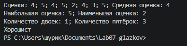
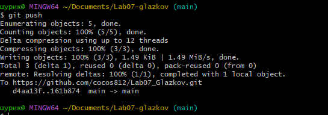

# Практическая работа №7

**ФИО: Глазков Александр**
**Группа: ИСП-242**
**Дата: 08.11.2026**

## Что изучено
- перебор массива через `foreach`
- `Length` указывает длинну массива 
- в `for` мы можем изменять тот или иной массив и прочие данные,а через `foreach` только читать

## Скриншоты

